# Content modelling skills: a guide

This plugin teaches Claude to model content in Umbraco 17+ the way an experienced Umbraco
developer would: consistent names, a tidy Document Types tree, compositions that do one job,
blocks with separate settings, and every page hung under the right parent with its template and
its SEO fields.

Every skill works the same way. **Claude writes the change down as a markdown requirements doc,
stops for your approval, applies it, then reads it back.** Nothing touches your site until you
have seen and approved the requirements doc.

## The concepts

One skill per concept. A template is what makes a page; everything else is schema that pages,
blocks and block areas are built from.

The definitions of the six concepts (page, document type, element type, block, composition and
block area), with the skill that owns each, are in the
[terms table](skills/umbraco-content-model-conventions/SKILL.md#terms).

## The skills at a glance

| Skill | What you ask for | What it produces |
|---|---|---|
| [`umbraco-content-model-conventions`](skills/umbraco-content-model-conventions/SKILL.md) | "What should I call this?", "Where does this go?" | Answers only. The rule book every other skill links into |
| [`umbraco-content-requirements-documentation`](skills/umbraco-content-requirements-documentation/SKILL.md) | "Write a schema requirements doc", "Apply the approved changeset" | The requirements doc format, the approval lifecycle, apply through the MCP or a manual walkthrough, verify, and a linter |
| [`umbraco-add-page`](skills/umbraco-add-page/SKILL.md) | "Add a contact page", "Add a landing page with a testimonial block" | One page: document type, template, SEO composition and parent, plus any block, block area or data type it needs, in one changeset with one approval |
| [`umbraco-add-document-type`](skills/umbraco-add-document-type/SKILL.md) | "Add a document type for offices" | The schema of one document type in the folder its role calls for, never a template. Other skills use it for a page's schema |
| [`umbraco-add-composition`](skills/umbraco-add-composition/SKILL.md) | "Add SEO fields to every page" | One single-concern composition, applied to the types that need it |
| [`umbraco-add-element-type`](skills/umbraco-add-element-type/SKILL.md) | "Add a testimonial element", "Add a spacing settings composition" | One element type: a content element, a repeater item, a settings model or a settings composition |
| [`umbraco-add-block`](skills/umbraco-add-block/SKILL.md) | "Add an accordion block" | A block: its content element, with a settings element and settings compositions when it has style options, and repeater items, placed in an existing block area if you name one |
| [`umbraco-add-data-type`](skills/umbraco-add-data-type/SKILL.md) | "Limit this to 160 characters", "Which editor should I use?" | Reuse or a new data type, the right property editor, name and folder |
| [`umbraco-configure-block-editor`](skills/umbraco-configure-block-editor/SKILL.md) | "Make the block available on the page" | A Block Grid per placement, or a Block List per repeater |
| [`umbraco-add-listing-page`](skills/umbraco-add-listing-page/SKILL.md) | "Add a blog", "Add a news section" | The listing and item page types as a pair, with a collection view |
| [`umbraco-add-data-folder`](skills/umbraco-add-data-folder/SKILL.md) | "Add authors", "Add categories" | A data folder and item at the content root, and the picker pages use |
| [`umbraco-add-site-settings`](skills/umbraco-add-site-settings/SKILL.md) | "Where do the logo and footer links go?" | The `siteSettings` singleton with tabs 0 to 9 |
| [`umbraco-change-document-type`](skills/umbraco-change-document-type/SKILL.md) | "Add a field to the article page", "Make the summary mandatory" | An Update of a type that exists, saying which changes lose content |
| [`umbraco-review-content-model`](skills/umbraco-review-content-model/SKILL.md) | "Audit our content model" | A report of what departs from the conventions, ranked, with the skill that fixes each. Changes nothing |

## How the skills fit together

Two skills are foundations. **Conventions** holds the rules and **requirements documentation**
holds the process. The builder skills hold only the decisions specific to what they build, and
link into the two foundations for everything else. That is why all of them must be installed
together.

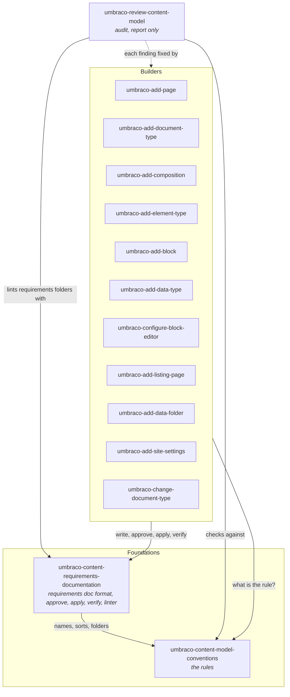

The skills are peers: each works on its own, and `umbraco-add-page` calls the others to bring
everything a page needs into one changeset with one approval. The peers decide and write; the
page skill merges and applies, leaves first.

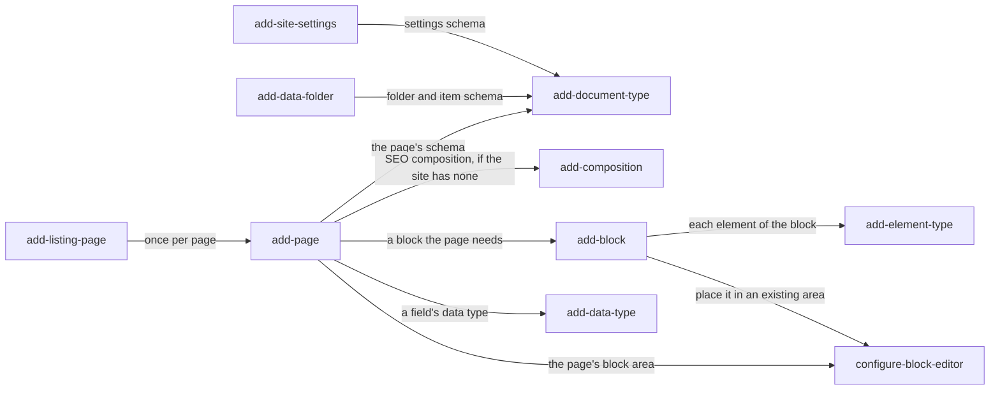

The builders also hand off to each other. A request outside a builder's scope is passed to the
skill that owns it, not half-built:

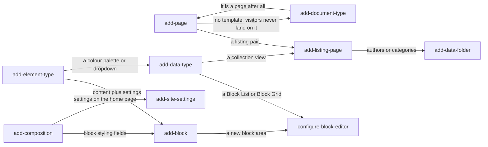

## One change, start to finish

Every builder follows the same six steps. Four of them belong to the requirements documentation
skill.

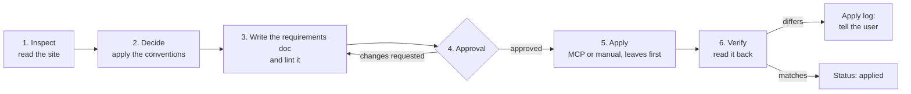

Each requirements page carries a status line that records where it is in that journey. A status
is a claim about the site, so `applied` is only written after the artefact has been read back, or
after you confirm you did the manual steps.

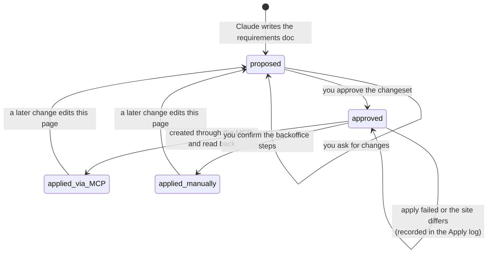

### With the MCP, or without it

There is one approach with two mechanisms. If the Umbraco Developer MCP is connected, Claude
applies the requirements doc itself. If not, Claude hands you a walkthrough generated from the
same requirements doc. There is never uSync, Deploy or `package.xml` output.

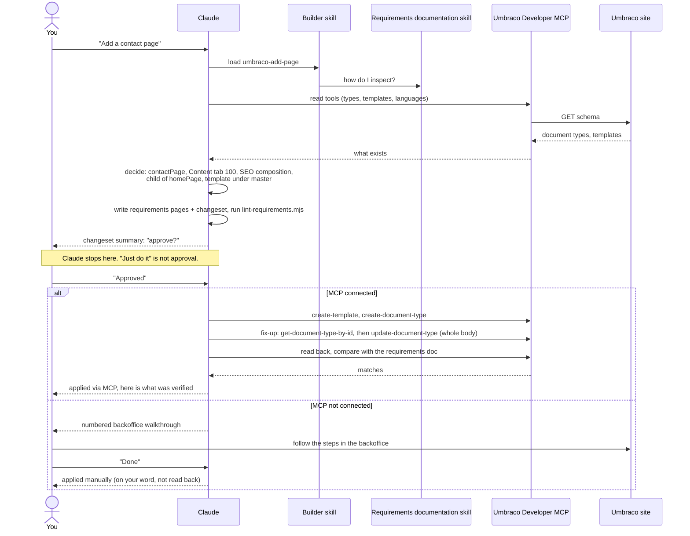

The **fix-up pass** exists because the MCP's create tools cannot set sort orders, mandatory flags,
descriptions, templates or culture variation. Claude creates the type, reads it back, edits the
body and writes the whole thing again, then reads it once more to confirm no property was lost.

## Building a site from empty

Here is the order the skills would run in to take a fresh Umbraco 17 install to a modelled site
with a home page, content pages, a blog, authors, blocks and site settings. Each step is its own
changeset and its own approval. Because every page takes SEO, the first page brings the SEO
composition with it.

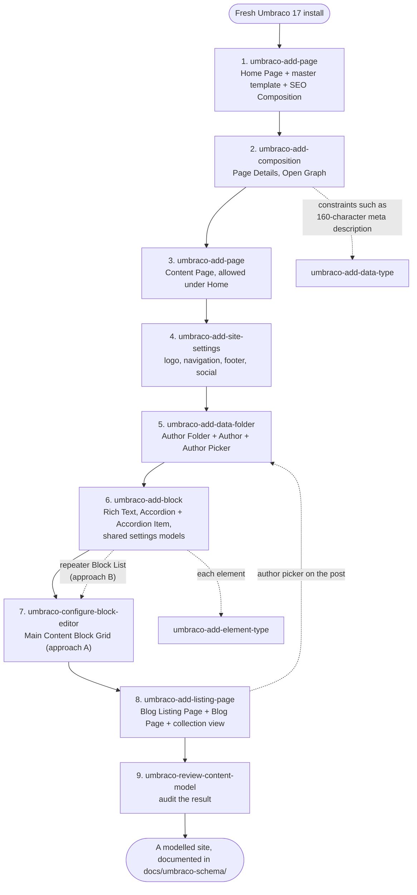

The order matters for the same reason the apply order inside a changeset matters: each artefact
needs the ids of the ones before it. Compositions exist before the pages that take them, elements
before the grid that registers them, the item type before the listing that allows it. A page that
needs a new block can take it in the same changeset: `umbraco-add-page` orders the block, the
grid update, the template and the page leaves first and asks for one approval.

### What a session looks like

A conversation building the blog section, showing where each skill comes in and where you are
asked to decide:

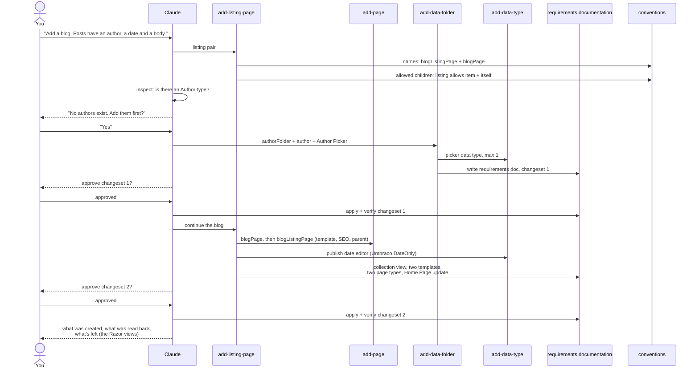

## What you end up with

The end goal is not only a modelled site. It is a site whose schema is **written down**. Every
change leaves requirements pages in your project, in a folder that mirrors the backoffice trees:

```
docs/umbraco-schema/
    README.md                         records where requirements docs live
    _changesets/
        2026-10-01-home-and-pages.md
        2026-10-02-blog.md            what was approved, the apply order, a tick-list, the apply log
    Data-Types/
        Content-Picker/Author-Picker.md
        Block-Grid/Main-Content-Block-Grid.md
        Collection-View/Blog-Listing-Page-Collection-View.md
    Document-Types/
        HomePage.md, ContentPage.md, BlogListingPage.md, BlogPage.md, SiteSettings.md
        Compositions/SeoComposition.md, PageDetailsComposition.md, OpenGraphComposition.md
        Data/AuthorFolder.md, Author.md
        Elements/Accordion.md, AccordionItem.md, RichText.md
        Elements/Settings/BlockSettings.md
    Templates/
        Master.md
        Master/HomePage.md, ContentPage.md, BlogListingPage.md, BlogPage.md
```

And on the site, a Document Types tree that anyone can read at a glance:

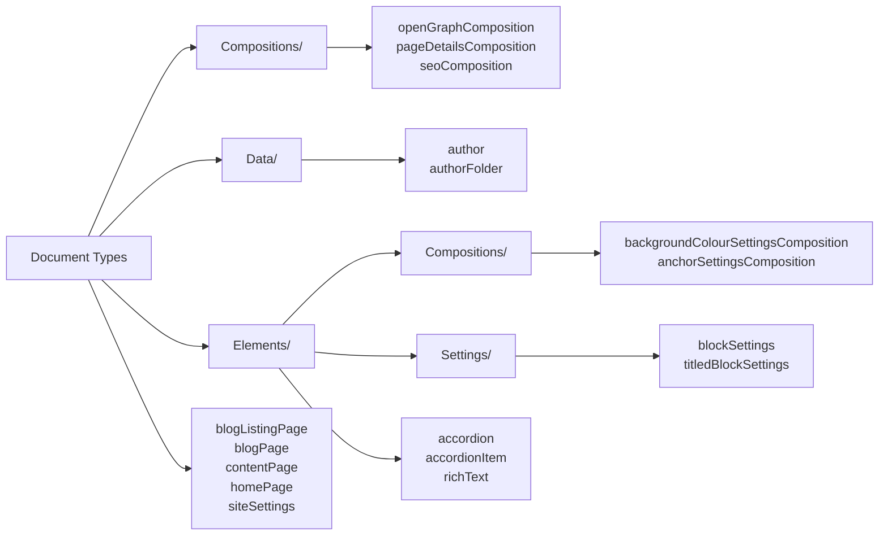

The content tree follows from the allowed-children rules: only the home page, site settings and
data folders sit at the root.

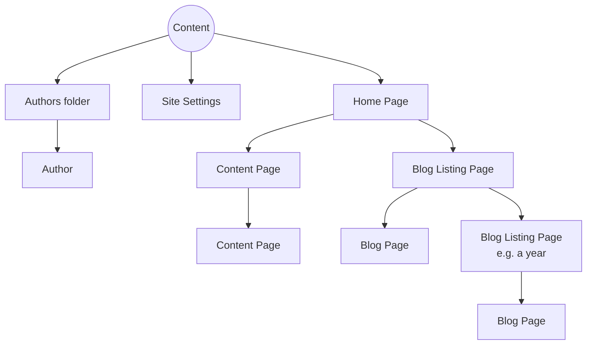

## Auditing an existing site

The review skill runs the other way: it reads a model and reports. It reads from the live site
through the MCP, from a requirements folder (running the linter first), or from an export you give
it, and it says which source it used. It never fixes anything. Each finding names the builder
skill that would fix it as a separate, approved change.

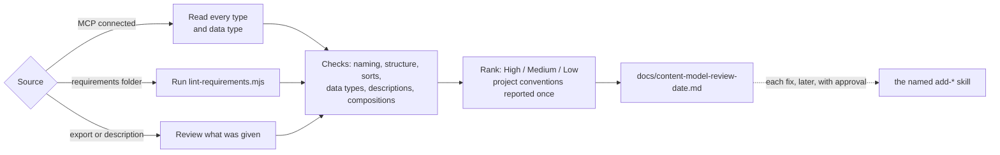

## What these skills will not do

- **Write code.** Razor views, controllers, block partials and content migrations are implementation
  work. The skills say when one is needed.
- **Change the site without approval.** "Just do it" is a request for the change, not approval of a
  requirements doc you have not seen.
- **Delete content to make room.** Moving fields into a composition, changing a property's editor or
  moving settings off the home page would lose stored values. The skills stop and say a migration is
  needed.
- **Leave a page without SEO.** Every page takes the SEO composition; if the site has none, the first
  page adds it in the same changeset. Sharing and page-details fields stay optional.
- **Claim more than they checked.** A create call that returned without an error is not proof. The
  report always separates what was read back, what you confirmed, and what was not checked (an icon
  colour, for one, cannot be validated).
